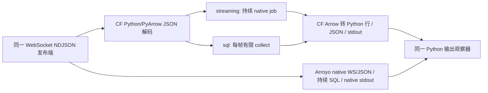

# DAL-417：两种执行引擎补测、性能归因与改进方案

本轮基线：启动时 `main@b9a10d4fa4b109b810d2f5839951912b92e597f8`，
calc-flow 2026.10.27。历史 #494 的 `dab98a5 / 2026.10.21` 证据完整保留。
本轮只测量、分析和设计方案，没有实施产品优化。

## 直接回答两个问题

**原实验使用 streaming 引擎。** 原脚本调用 `TableExpr.stream()`，内部构造
`Program("stream", engine="streaming")`，经 `StreamResults` 启动 native
`StreamingRunner`。转换用表达式节点，窗口用原生 event-time window 节点；没有 SQL 节点。
它是持续作业接收一系列小批输入，结果在 EOF 前输出，不能把原比值解释成纯批计算结论。

已补测另一种 `Program.engine="sql"`，使用同一表达式图和相同输入。在在线 512 行帧下，
SQL 每帧有限 `collect_async` 的吞吐约 19.5 万行/秒，持续 streaming 约 29.9 万行/秒，
Arroyo 约 58.1 万行/秒。把有限接口放进 WebSocket 循环是本实验的应用适配，不会赋予它
持久流状态、watermark finality 或原生持续 runner 的语义。

**差距主要指向小批调用、规划/调度和数据适配，不能归结为算术内核慢。** 在预先准备的
32,768 行整表 Arrow 对照中，SQL 一次有限 collect 中位数 4.32ms、预编译 batch plan
2.999ms；streaming 的源放行到 Arrow 输出为 2.50ms。该 streaming 计时不含 job 启动，
SQL convenience 包含每次新计划准备，因此用预编译对照帮助区分便利层成本。
这里没有 Arroyo 的等价有限批接口结果，不据此宣称批引擎胜过或落后于 Arroyo。

建议先处理已有接口用法和 JSON 路径，再处理反复执行的计划准备、回调调度；不优先重写
窗口内核或替换 DataFusion。下文给出证据、收益模型、工作量和兼容验收。

## 引擎、节点和执行方式的证据

三个概念需要分开：

- `Program.engine` 选择有限执行或持续执行生命周期，不代表换掉底层 Arrow/DataFusion。
- 表达式节点与 SQL 节点是图中的算子类型；两种引擎都可以包含适配其生命周期的节点。
- 输入是否一次到齐、是否重复调用有限接口、何时输出，是另外的输入/运行边界。

本轮复用保留的历史 wheel，先核对 native SHA-256
`b9e63aef83465ba675ff96c449729f3d474abeac7abbec65af6f21ab12c8f267`，
再导出原声明图和真实 Python 入口源码；没有重新获取历史性能样本。
证据位于原始包的 `historical-probe/`，包括 `internal-stream-entry.py.txt`。

当前两个引擎的表达式声明 fingerprint 完全相同：
`298cfca33072865f68c312d5a1579f60ddbb3be21515d2383248d46d0c4bfa4e`。
导出的图均只有一个融合表达式节点，过滤为 `id >= 0 AND k < 8`，输出为 `id, x*2+1`。
相邻过滤/投影**已经融合**，不能以“拆成三个小算子”解释原转换差距。
导出一个明确使用 `.sql(...)` 的图则会出现 `kind="sql"`，证据也单独保存。

本轮实际有限执行的 `RunResult.datafusion_metrics` 保存了逻辑及物理计划：

```text
ProjectionExec: expr=[id@0 as id, x@1 * 2 + 1 as y]
  FilterExec: id@0 >= 0 AND k@1 < 8, projection=[id@0, x@2]
    DataSourceExec: partitions=1, partition_sizes=[1]
```

历史测量没有导出 DataFusion 物理计划；历史图导出和当前物理计划分别标识，未把当前计划
回写成历史实测计划。固定源码的 `DataFusionRuntime::stream_expression` 在模板匹配时
提供 cached compiled-expression 分支；公开 streaming status 没有物理计划字符串或
cache-hit 次数。本轮确认了持续 runner、融合图和实际 operator/runtime status，未伪称
导出了该分支的命中计数，也不把有限重复执行的物理规划次数套用到 streaming。



## 版本、资源和范围

| 项目                      | 历史证据                                               | 本轮证据                                                                |
|---------------------------|--------------------------------------------------------|-------------------------------------------------------------------------|
| calc-flow                 | `dab98a559314bd46d866ed7a6489abcdd3810afe`，2026.10.21 | `b9a10d4fa4b109b810d2f5839951912b92e597f8`，2026.10.27                  |
| native                    | `b9e63aef…f267`                                        | `a0708fcf…bfb8`，同一 wheel 供本轮两引擎使用                            |
| Arroyo                    | v0.15.0 / `4ef15f6336a596651f10cf27c1ee29c29bf81577`   | 同一个 binary，SHA-256 `558b28b4…319f`                                  |
| Rust / DataFusion / Arrow | Rust 1.94.0 / DF 55 / Arrow 59.2                       | 同系列，但 lock 与源码有变化                                            |
| Python 适配               | CPython 3.13.9、PyArrow 24、websockets 15.0.1          | 相同已解析 Python 依赖，另建隔离 venv                                   |
| 主机                      | WSL2 Linux、i9-13900HX、32 逻辑 CPU、约 31GiB RAM      | 同机；worker affinity 4–7，controller 0–1，Tokio 4 threads，Arroyo -p 1 |

当前 lock 包括 Tokio 1.52.3→1.53.3、Arrow IPC/Parquet 的 vendor 来源及压缩依赖变化；
API/runtime 也有 snapshot SQL、SQL 聚合与状态预算等更新。`compute.py` 和
`operator/expression.rs` 在两 ref 间没有内容差异，但不能据此认定整个执行环境等价。
历史 2.26×/4.50× 仍是原报告的结论来源；本轮独立采样，不对跨日期、不同构建/驱动的
数值变化作版本改善/回归判断。

当前文档/源码明确区分可使用 compact state 的 SQL 聚合与保留历史的 fallback；不能把
历史功能矩阵中的累计 SQL 概括无条件应用到当前所有聚合。本轮投影和原生窗口也不经过
这些普通累计 SQL 优化路径。

新 release 以原 Cargo cache、默认 file feature、locked dependencies、thin LTO/
codegen-units=1 构建，耗时 **9m46s**。wheel SHA-256
`c7353872880b2c511aab3d290aff181795809e3818007159379d0f9a02f07753`；
载入 native SHA-256
`a0708fcf5fa84a1cf2c5347a66b73680d7426a3313746a1ef99519d5b2c7bfb8`。
构建记录核对了 wheel 内 native 与实际 import native，所有 CF worker 都检查同一 seal。

本轮预记五个 workload、每组五次；四个三路径场景按 ABC/CBA、一个双路径场景按 AB/BA
交替，共 **70 次正式观测**；
另有八次预记诊断。正式及诊断共 104.68 秒，成功预检 7.36 秒，语义 probe 0.40 秒；
身份初始化失败发生在任何 worker 启动之前，日志保留。测量远未用满预记的 600 秒预算，
未追加规模或重复至有利结果。构建和编写/读源码时间另计。

主机没有 CPU 独占、锁频或 swap 禁用保证，RSS 按约 10ms 采样整个引擎进程树，可能漏掉
短峰值；core 的数毫秒样本尤其不能代表稳定峰值内存。保留 load/memory 前后快照。
原 `rss_peak_bytes` 在结果校验后、停止前读取，包含启动及校验阶段；完整 `memory.json`
继续采样到进程退出。离线摘要另列 `rss_peak_through_shutdown_mib`，不混淆两个边界。
数据是描述性跨引擎比较，没有冒用仓库两轮成对置信区间门禁或判定 `no-change`。

## 输入、计时和窗口等价性

仍是 32,768 行、16 key、整数 `x=(id*17)%101-50`，每 512 行事件时间推进两秒。
live 都追加 512 行过滤 marker，有效/线上输入为 32,768 / 33,280 行。
8,192 行帧只是拼接原 JSON 字节，顺序和值不变；所有 live 的输入 SHA-256 均为
`7d9082c1eca4df18956e7db3a373fbf3942d5b98565e61e0d6f890c4d7617096`。
Arrow 场景移除 marker，整表固定为一个 32,768 行 record batch，小批为 64×512。

live 从首 `send` 前到观察器收到最后输出行，包含 JSON、loopback、任务/通道、计算、
stdout 以及观察器自身解析/记录；不含 fixture、进程启动、完整 oracle 和停止。
CF/Arroyo source 连接不等同于全部惰性初始化完成，首批剩余准备仍可能被计入。
Arroyo 也受到 Python 观察器限制，因此这些吞吐不是最大可持续引擎吞吐。
发布端整个 burst 的 send 起点跨度约 0.4–0.9ms，只说明应用 enqueue 很快，不等于传输完成。
逐行延迟从对应输入帧的 send 起点计算；窗口表中从该窗口最后一帧有效数据的 send 起点
计算，另将关闭窗口所需进度帧的 send 起点到输出记录为 `progress_latency_ms`。这两种
延迟都不是事件时间宽度，也不包含发布前的攒批等待。

Arrow 从源放行/首有限调用到全部 Arrow 输出，不含 fixture、JSON、网络、job 创建及
最终 oracle/退出；streaming 输入在得到结果前保持开放。SQL convenience 每次准备新的
native plan，`sql_plan` 对照只把同一声明的 native plan 编译移到计时外并重复使用，
不是另换算法。双方的输入边界、输出、编译位置及 DataFusion 运行阶段都保留在原始记录。

窗口的相同原生声明在 `engine="sql"` 上被拒绝：
`outputs.result: unsupported_mode: window_tumbling requires the streaming engine`。
有限全表 `GROUP BY FLOOR(EXTRACT(epoch FROM ts)/4)` 可以精确对齐最终 512 行，但每帧
单独查询首帧得到的 count 为 32，原窗口完整 count 为 64；即使累积后重算，也会产生
中间快照且需自行定义 finality。它不等价于原 watermark 提前输出，本轮不把它列作
窗口引擎速度排名。

窗口输出由数据进度关闭，不依赖 EOF；四秒是事件时间宽度，发布并未按墙钟等四秒。
checkpoint 边界与历史一致：CF disabled，Arroyo interval=1h 且保留其恢复记账，停止后的
final checkpoint 不计时；这里不比较恢复或 exactly-once。全部实测精确核对整数数学值，
不要求两系统 Arrow nullability/整数位宽元数据完全一致。

## 正式结果

全部 70 次样本和 988,160 条输出通过离线复核。表中为五次中位数，括号是 min–max；
live 吞吐单位千行/秒、逐输出延迟单位 ms。P50/P95 是各次逐行分位数的五次中位数。

| 场景            | 执行路径            | 吞吐（千行/秒，范围）      | P50 / P95（ms） | 停止前 RSS 峰值中位数（MiB） |
|-----------------|---------------------|----------------------------|-----------------|------------------------------|
| live-512        | CF streaming        | 298.6（245.8–332.5）       | 60.70 / 104.04  | 204.7                        |
| live-512        | CF sql 每帧有限调用 | 194.9（158.6–212.9）       | 88.47 / 159.38  | 204.7                        |
| live-512        | Arroyo 持续 SQL     | 580.9（519.0–757.1）       | 31.35 / 53.81   | 212.2                        |
| live-8192       | CF streaming        | 319.6（296.2–343.6）       | 70.73 / 100.37  | 204.4                        |
| live-8192       | CF sql 每帧有限调用 | 311.9（282.8–327.0）       | 74.50 / 102.97  | 204.6                        |
| live-8192       | Arroyo 持续 SQL     | 659.5（566.7–701.9）       | 29.64 / 47.59   | 224.2                        |
| window-live-512 | CF streaming        | 350.8（337.2–403.7）       | 61.03 / 92.03   | 204.5                        |
| window-live-512 | Arroyo 持续 SQL     | 2,046.0（1,552.4–2,144.5） | 11.00 / 15.13   | 221.5                        |

把停止与最终 checkpoint 阶段也纳入，Arroyo 三个场景的全程 RSS 峰值中位数分别为
219.1 / 229.8 / 227.4MiB；CF 各组中位数不变。完整范围保存在 `summary.json`，不能
将停止前表格当作包含 final checkpoint 的全程峰值。

live-512 的相邻成对 Arroyo/CF 比值中位数为 streaming **1.965×**（1.636–3.050）、
SQL 每帧 **3.514×**（2.438–3.865）。live-8192 分别为 **2.063×**（1.649–2.264）和
**2.117×**（1.817–2.238）；窗口为 **5.068×**（4.547–6.114）。这些是成对比值的
中位数，不等于表中两组中位吞吐的商。

| Arrow 场景 | 执行路径                  | 32,768 行完成时间（ms，范围） | 吞吐中位数（百万行/秒） |
|------------|---------------------------|-------------------------------|-------------------------|
| 整表       | CF streaming，已建 job    | 2.498（2.417–3.646）          | 13.119                  |
| 整表       | CF sql collect_async      | 4.315（4.129–4.415）          | 7.594                   |
| 整表       | CF sql 预编译 native plan | 2.999（2.634–3.474）          | 10.925                  |
| 64×512     | CF streaming，已建 job    | 19.526（18.062–24.375）       | 1.678                   |
| 64×512     | CF sql collect_async      | 72.755（66.943–74.645）       | 0.450                   |
| 64×512     | CF sql 预编译 native plan | 48.855（48.087–54.816）       | 0.671                   |

整表数毫秒结果不含启动，样本仅五次；它不是持续吞吐承诺。预编译/collect 的成对吞吐比
中位数在整表为 1.457×、64 小批为 1.392×，支持便利层存在可见准备成本。
不能把不同 batch workload 的组中位数比冒称成同形状的成对版本改善。

## 分层证据与已排除的解释

诊断运行同时启用了 phase clocks、cProfile 和现有 bounded native callback tracing，
会扰动 GIL 和调度。下列毫秒数属于各自诊断运行，不代替上述正式结果；阶段有重叠，
不能直接相加、从正式总时间相减，或把等待时间当 CPU 时间。
cProfile 主线程还覆盖启动/校验/等待/清理，其中 `epoll.poll` 超过一秒的时间不是被测
计算瓶颈；它不采样 Rust 内核或输出线程 Python 栈，输出线程用显式 phase clock。

### JSON/I/O 与 Python 对象化

| 诊断                          | 解码 JSON       | Arrow→Python 行 | JSON 编码 | pipe write+flush | 等待输出线程 |
|-------------------------------|-----------------|-----------------|-----------|------------------|--------------|
| live-512 streaming，151.21ms  | 39.89ms / 65 帧 | 11.51ms         | 59.18ms   | 4.78ms           | 139.14ms     |
| live-512 sql，206.40ms        | 28.23ms / 65 帧 | 10.83ms         | 57.56ms   | 1.22ms           | 84.79ms      |
| live-8192 streaming，115.54ms | 22.99ms / 5 帧  | 9.66ms          | 55.56ms   | 0.85ms           | 72.68ms      |
| window streaming，97.86ms     | 28.88ms / 65 帧 | 1.48ms          | 2.57ms    | 2.75ms           | 47.13ms      |

输出仍逐行 `to_pylist → json.dumps`，增加帧大小不会减少 16,384 个 Python dict/JSON 行；
实际编码时间也未明显下降。`thread_await` 已包含序列化/写出和线程调度，不能再与它们
相加。pipe 系统调用阶段远小于对象化/编码，不能只归咎于 stdout 带宽。
Arroyo 走原生 JSON/stdout，CF 测试适配存在不同工作量；观察器又是双方共同成本。

### Arrow/PyO3 包装与回调调度

Arrow-512 streaming 诊断墙钟 26.66ms，operator 的累计 processing 为 **3.172ms**。
同批形状的独立 `Batch.from_pyarrow`/`to_pyarrow` 64 次 roundtrip 合计 **0.681ms**，
返回值完全一致。本轮没有采集 copy 字节数，不能把该包装探针以外的全部开销归因于
Arrow 数据复制。
在线 cProfile 中，65 次 `from_pyarrow` 累计约 1.13ms，`_table_batch` 约 1.73ms，
65 次 `to_pyarrow` 约 4.33ms，同样不足以解释全部在线差距。

实际回调追踪在 Arrow-512 中记录了 63 个已完成 source.next 和 64 个 sink write：
source 的 queued→dispatched 累计 8.59ms，sink 为 8.26ms；回调总 elapsed 分别为
20.35/21.80ms，二者相加大于 26.66ms，体现重叠。首个 source poll 在打开 profile 前已经
开始，未计入 63；所有诊断 `dropped=0`。不能把这些累计值直接视为可回收墙钟。

profile 中的 attached/queued/dispatched/completed 是从同一次 callback 起点计算的
阶段偏移，`analyze.py` 先取相邻差值。attached 之前含进入 Python 与准备的开销，
不能当作经过独立分离的纯 GIL 锁等待计时。native await 桥的真实调度成本已观测到；
其中多少由 JSON 输出线程争用 GIL 诱发，仍是待干预验证的因果假设。

### native plan 预编译不等于跨调用复用 DataFusion 物理计划

Arrow-512 预编译 SQL 诊断为 57.13ms。64 次 native execute await 合计 49.61ms；
对应 metrics 为 **64 次查询、64 次物理规划**：

| 阶段                                             | 累计时间  |
|--------------------------------------------------|-----------|
| session state 创建                               | 5.55ms    |
| logical planning                                 | 6.22ms    |
| physical planning                                | 15.96ms   |
| execution                                        | 2.07ms    |
| 其中 physical elapsed compute                    | 1.44ms    |
| logical/physical plan 字符串与 metrics traversal | 约 0.79ms |

`BatchExecutionPlan.execute` 每次建立 run-scoped DataFusionRuntime；图的编译已提前，
但 session 与物理规划仍反复发生。另一方面 `collect_async` 还会按接口契约准备新 native
plan，经 `asyncio.to_thread` 做 lowering/compile。本轮 SQL live-512 的该准备阶段累计
11.53ms，整个 collect await 90.62ms（诊断）；它与 worker/输出线程阶段不能无条件相加。

整表 SQL 预编译诊断只规划一次：session 0.469ms、planning 1.045ms、execution 0.321ms，
说明小批反复固定成本与算术执行成本必须分开。当前场景中，优先消除重复准备比优化乘加
内核更有依据。streaming 已有 operator-scoped runtime 和 compiled-expression 热路径；
源码机制与短 operator 时间相符，但命中次数未独立打点，不应重复提出“新增缓存/融合”
而不先核对既有实现的覆盖范围。

### 批大小、状态与进度

将 live 帧从 512 增至 8192，SQL 的完成时间组中位数为 168.11→105.05ms；streaming
只有 109.75→102.52ms。前者的固定调用成本得到摊薄，后者仍受 JSON 输出等限制。
这些是两个场景的描述性对照，不是版本改善门禁。大帧还增加等待攒批及首结果延迟风险。

window 诊断的 native window operator 累计 processing **2.408ms**（其中 watermark
processing 0.536ms，是子集）；前置过滤约 2.902ms、identity/projection 共约 0.557ms。
窗口状态/进度确有成本，但本实验不是其占主导的证据。所有 edge 的 blocked_sends 为 0，
没有证据把差距归为 edge credit 饱和；sink callback 的等待仍可发生。

原窗口把 data 与显式 Watermark 分别跨 Python 源回调传入。该诊断记录 129 个 completed
source.next（一个初始 poll 未追踪），而普通转换仅约 64 个；窗口的输出却只有 512 行。
Arroyo 在原生图里生成 watermark。减少这个控制消息的跨语言调度值得验证，但不能减少
必须的进度语义、把 watermark 合并到越过 checkpoint 的位置或丢弃背压。

停止阶段 native job 出现 cancelled/source error 是预定 SIGINT/关闭等待源的结果，不是
计时中结果错误，也不是恢复或资源清理门禁通过。没有 Rust 符号采样工具（本机未安装
perf/py-spy）；细到窗口 key/hash/内存分配函数的热点仍没有证据，不能据此开内核重写。

## 按优先级分阶段的提升方案

以下是待后续任务实施/验证的方案，不是本 PR 的优化效果。工作量按熟悉代码的一名开发者
的人日粗估，不含排队/跨平台 CI。收益中“目标”是待验证估计，“模型上限”仅在当前诊断
边界内、假设阶段位于关键路径且无重叠/反馈变化的乐观 Amdahl 模型，不能跨场景相加。

### 阶段一：先兑现已有接口和集成路径的收益

**P0：有限小批调用复用已编译声明，并采用有延迟上限的攒批。**

- 位置：`python/calc_flow/compute.py:149–180,283`、`symbolic/program.py` 的 collect/compile，
  应用 source 的批形成边界。此处是复用公开接口的用法改进，不要求改变产品语义。
- 证据：预编译/collect 在 64 小批中的成对吞吐比 1.392×，整表为 1.457×；SQL 在线大帧
  105ms、小帧 168ms。streaming 在线大帧收益小，不能统一推广。
- 拟改动：高频有限任务使用公开 `compile_batch` / `Runtime.compile_batch_project` 与明确
  physical binding；避免对每个微小 frame 重走 convenience 准备。只在流量/延迟预算允许时
  攒到 512–8192 行并设置 max linger。诊断脚本的 `_lowered_collect` 是私有入口，不作应用 API。
- 收益与上限：本固定 Arrow 负载已观测到约 1.39–1.46× 的成对中位数控制结果；未来线上
  SQL 路径可先以 10–30% 的完成时间下降为验证目标。纯移除便利层的空间不能包含剩余
  DataFusion session/物理规划成本；这些仍由下阶段处理。
- 工作量：0.5–1 人日；兼容风险低到中。需保护每次独立执行的状态、注册/UDF snapshot、
  输入不可变性和取消所有权。流式窗口不能直接改成每帧有限调用。
- 验收：同一 oracle/输入顺序及 public API 行为；同时报告吞吐、首结果和 P95。攒批等待
  上界需写入 SLA，例如 50k 行/秒时仅攒满 8192 行就可能增加约 164ms，不能只验吞吐。

**P1：消除输出侧逐行 Python 对象/JSON 循环，或在允许时保持 Arrow 输出。**

- 位置：本轮 `engines.py:76` 及原测 `cf_worker.write` 的集成 sink，`stream.py` 的 QueueSink；
  可结合已有 native connector/Arrow sink 扩展，不先动乘加内核。
- 证据：dense 输出对象化+编码约 71ms，pipe write/flush 约 4.8ms；8192 行帧仍编码约 56ms。
  窗口 sparse 输出的相同阶段仅约 4ms，场景敏感性明确。
- 拟改动：Arrow 消费者保持 Arrow/IPC，不转 Python dict；必须输出 JSON 时评估 native
  Arrow JSON sink/批量编码，保留 schema、数值/null/timestamp、错误与 backpressure 边界。
- 收益与上限：以 JSON 编码阶段减半为第一目标，按 151.2ms 诊断模型最多节约 29.6ms，
  约 1.24×；即使该 59.2ms 编码阶段全消失，单独模型上界也约 1.64×，不是 5× 承诺。
  改 Arrow 输出会改变外部协议，应另列场景，不能冒充同一 JSON workload 改善。
- 工作量：2–4 人日原型，另留 1–2 人日类型/错误/慢 sink 验证；风险中。需检查 decimal、
  特殊浮点、时区、嵌套类型、输出顺序及 bytes budget，不能以异步排队尚未完成当作写出。
- 验收：字节/数值语义符合已声明 JSON contract；计时到实际可见输出；dense 输出阶段
  中位数至少下降 50% 的候选目标，同时守住窗口 sparse 输出和取消/资源边界。

**P1：原生源和原生 watermark 策略先做语义对齐，再减少 Python 控制回调。**

- 位置：`_stream_inputs.py:145`、`runtime.py` watermark policies、
  `crates/calc-flow-connectors/src/websocket.rs` 与 `json_lines.rs`。
- 证据：窗口 129 个 completed source 回调、JSON 解码约 28.9ms，而状态内核约 2.4ms；
  源/控制路径比改状态计算更值得先试。
- 拟改动：优先定向核对现有 `BoundedOutOfOrderness` 在 ts 列、1us 乱序上限及适当
  emit_interval 下，能否在 Rust 侧产生与原 `max_seen-1us` 策略相同的轨迹；再评估
  native WebSocket JSON source。现 connector 不提供
  JSON schema override，`ts` 的字符串/时间类型和 watermark 能力必须先对齐，不能直接替换。
- 收益与上限：尚无干预结果，先以 0–20% E2E 下降为验证区间，可能为零。129 个源回调
  的 elapsed 包含解码与重叠等待，不能全额回收；把其约 80.8ms 扣除解码后剩余约 52ms
  全当可消除费用，97.9ms 诊断的宽松模型上界也仅约 2.13×，实际策略改动应远低于此。
- 工作量：0.5–1 人日策略语义 probe；若需 codec/schema 支持，再 3–6 人日；风险中高。
  需要保留 late/idle、同时间跨帧、控制顺序、backpressure、epoch 和 replay 能力声明。
- 验收：原负载完整输出与 watermark trace 相同，输出仍在 EOF 前；出现乱序/空帧/同时间
  拆帧时不提前 final。只有语义对齐后才做受限成对性能验证。

### 阶段二：减少高频有限执行与持续桥接的固定成本

**P2：在独立 run 所有权下复用不可变 DataFusion 计划模板。**

- 位置：`crates/calc-flow/src/pipeline/batch.rs:406–422`、`datafusion.rs:618,785`、
  `datafusion_template` 的 schema/表达式模板绑定；Python convenience 编译层另作薄化。
- 证据：预编译 native plan 仍做 64 次物理规划，session+planning 27.73ms，execution
  2.07ms，表明“图已编译”没有消除重复 DataFusion 准备。plan 字符串/metrics 仅约 0.79ms，
  单纯关闭 diagnostics 不能填平主要差距。
- 拟改动：缓存不可变的 schema/UDF/version/config 决定的 logical/physical expression 模板，
  每 run 新建受所有者管理的输入绑定、结果、取消及内存预算；不能共享可变 MemTable 或
  保留调用者输入。借用 streaming 已有 compiled-expression 设计，不重复实现同类缓存。
- 收益与上限：在该诊断 49.61ms execute await 内，session+planning 全消失的理想上界
  2.27×；整个 57.13ms Arrow 诊断模型上界约 1.94×。先取 1.3–1.6× Arrow 小批吞吐目标，
  对在线 JSON 路径只预期更小收益；不是对所有 SQL/UDF 的承诺。
- 工作量：5–8 人日，风险高。必须处理并发调用、UDF registry snapshot、volatile 函数、
  schema/metadata/配置变化、deadline/cancellation 和预算 accounting；先限制在可证明
  row-local/纯表达式 eligible 子集，fallback 行为保持明确。
- 验收：不破坏 fresh-run、不可变输入、错误路径及公共 API；记录 physical planning count
  是否下降。候选目标为 eligible 小批规划成本下降至少 50%，不放宽正确性和内存门槛。

**P2：合并可证明安全的回调/通知工作，保留流的控制边界。**

- 位置：`crates/calc-flow-python/src/runtime.rs:530` 的 Python await bridge、
  `continuous.rs`、`stream.py` 的 QueueSink/结果迭代和 source/sink 调度。
- 证据：Arrow-512 26.66ms 诊断只有 3.17ms operator processing，裸 Arrow bridge
  roundtrip 0.68ms；队列到 Python dispatch 累计 source/sink 各约 8ms，证明需要区分
  轻量包装和异步 orchestration。它不是“PyO3 数据复制占全部时间”的证据。
- 拟改动：评估已准备 Arrow 输入的 native-source 路径、成组 callback/结果通知，减少
  `call_soon_threadsafe`/future/单批队列往返；数据与 watermark/barrier/EOF 不跨边界合并。
  JSON 输出线程造成多少 GIL 争用，应在第一阶段之后再做干预定位。
- 收益与上限：暂取 10–30% Arrow 小批路径下降目标，仍待验证；26.66−3.17=23.49ms 只是
  全部非算子余项的宽松预算，不是独占可优化时间，不能把所有 callback elapsed 相加求上限。
  仅消除当前 0.68ms 裸 bridge 的乐观模型上界约 1.03×，所以不优先重写 C Data Interface。
- 工作量：3–5 人日原型加生命周期验证，风险高。需要覆盖 owning references、GIL、取消、
  重入、结果队列背压、delivery ack、异常及 source close，保持公开异步所有权契约。
- 验收：同一阶段计时与 path-use 证据；取消后无悬空回调/引用、慢 sink 下资源有界；先在
  Arrow-512 证明收益，再检查 dense/sparse live 场景，避免只移动计时边界。

### 阶段三：状态内核只在新热点证据出现后推进

**P3：不以当前结果启动 window key/hash/聚合内核重写。**

- 位置：`operator/window.rs` 及 `runtime/streaming/operator_task.rs`；窗口基数/类型扩展时
  才补带符号的内核剖析，先确认实际热点，再考虑 key 编码、批量聚合或状态发布。
- 证据：当前 native window processing 2.408ms/97.855ms；即使该阶段完全消失，单独
  乐观模型上界约 1.025×，远不足以解释或解决 5× 的集成比值。
- 拟改动与收益：本轮不建议产品内核改动；现负载收益预算接近零。高 cardinality、偏斜、
  大窗口、不同类型可能有新瓶颈，但目前没有速度或收益上限证据。
- 工作量：未来若有触发，先 1 人日带符号 profile；实施范围/收益另定，不能预收“数倍优化”。
  风险高，涉及状态布局/检查点、lineage/fingerprint、late handling、恢复与预算。
- 验收：以新确认热点为依据，并保留恢复/控制语义及仓库已有门禁；本轮不新增优化任务。

各阶段先用本报告五个 workload 中的直接相关 subset 加必要边界作为验收集合；正式版本
改善与不回归判断仍采用仓库规定的 sealed build、匹配身份和成对统计门禁，不用单次最小值。
全量、跨平台、总覆盖率及常规性能门禁交现有 CI；不能为交接重复测量。

## 证据缺口与交付

没有同协议下完全剥离 I/O 的 Arroyo 纯批计算结果，没有 native Rust flamegraph，也没有
隔离 GIL/事件循环/OS 调度各自因果份额。没有长期稳态、大状态、故障恢复或事务 sink 实测。
当前 evidence 足以否定“原测是纯批 SQL”及“差距主要已证明在窗口算术内核”的解读，
但不能把剩余差值唯一归给一个 Rust 函数，也不能把方案的模型上限当成已实现收益。

原始包保存 70 次样本的全部 output/arrival/send/memory、八次 phase clocks/cProfile/
callback/DF metrics、历史/当前图、有限窗口语义 probe、构建与 native seal、失败预检。
`summary.json`、`paired-ratios.json`、`diagnostic-summary.json` 由脚本离线复算，
`audit.py` 核对原始值、计时、输入哈希、worker seal、顺序和精确测量脚本哈希。
阅读、重现与离线验证命令见 [README.md](README.md)，本轮不改 #494 历史文件。

固定源码入口：

- [当前 Program 执行分派](https://github.com/wegamekinglc/calc-flow/blob/b9a10d4fa4b109b810d2f5839951912b92e597f8/python/calc_flow/symbolic/program.py)、[stream 入口](https://github.com/wegamekinglc/calc-flow/blob/b9a10d4fa4b109b810d2f5839951912b92e597f8/python/calc_flow/stream.py)。
- [当前有限准备](https://github.com/wegamekinglc/calc-flow/blob/b9a10d4fa4b109b810d2f5839951912b92e597f8/python/calc_flow/compute.py)、[batch run](https://github.com/wegamekinglc/calc-flow/blob/b9a10d4fa4b109b810d2f5839951912b92e597f8/crates/calc-flow/src/pipeline/batch.rs)。
- [DataFusion 执行/模板路径](https://github.com/wegamekinglc/calc-flow/blob/b9a10d4fa4b109b810d2f5839951912b92e597f8/crates/calc-flow/src/datafusion.rs)、[ExpressionOperator](https://github.com/wegamekinglc/calc-flow/blob/b9a10d4fa4b109b810d2f5839951912b92e597f8/crates/calc-flow/src/operator/expression.rs)。
- [native await 桥](https://github.com/wegamekinglc/calc-flow/blob/b9a10d4fa4b109b810d2f5839951912b92e597f8/crates/calc-flow-python/src/runtime.rs)、[callback profile 定义](https://github.com/wegamekinglc/calc-flow/blob/b9a10d4fa4b109b810d2f5839951912b92e597f8/crates/calc-flow-python/src/runtime/profile.rs)。
- [当前窗口实现](https://github.com/wegamekinglc/calc-flow/blob/b9a10d4fa4b109b810d2f5839951912b92e597f8/crates/calc-flow/src/operator/window.rs)、[WS schema/watermark 边界](https://github.com/wegamekinglc/calc-flow/blob/b9a10d4fa4b109b810d2f5839951912b92e597f8/docs/connectors/websocket.md)。
- [历史报告与证据](../arroyo-comparison/README.md)，[固定 Arroyo WS 源](https://github.com/ArroyoSystems/arroyo/blob/4ef15f6336a596651f10cf27c1ee29c29bf81577/crates/arroyo-connectors/src/websocket/operator.rs)、[固定 stdout sink](https://github.com/ArroyoSystems/arroyo/blob/4ef15f6336a596651f10cf27c1ee29c29bf81577/crates/arroyo-connectors/src/stdout/operator.rs)。
