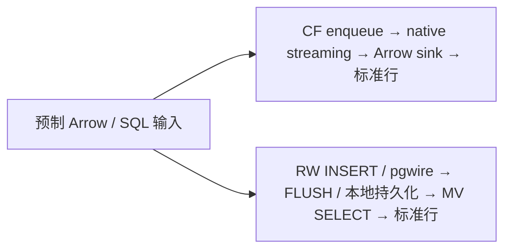

# RisingWave 与 Calc Flow streaming 专项比较（DAL-416）

2026-10-22，中文报告。范围是固定版本的单机合成负载、功能探针与一手资料调研。
只新增测量脚本和证据，不修改产品逻辑。本报告中的“实测”“源码/文档支持”“未验证”分开陈述。

## 判断与适用场景

Calc Flow 适合把有状态计算嵌入 Python/Arrow 应用：进程内传递批次，直接取得结果，
原生 rolling、事件时间窗口和受界限约束的 join 可组合在同一作业里。
本次恢复探针也实际执行了跨批 rolling 状态恢复。
接口和部署边界见固定版本的 [Calc Flow introduction][cf-intro]、[streaming guide][cf-stream]。

RisingWave 适合需要持续维护数据库结果、处理表的更新/删除、让多个 SQL 客户端查询结果的服务。
本次确实观察到 `UPDATE`/`DELETE` 修正聚合物化视图，以及持久化结果在进程被杀死后恢复。
分布式调度、对象存储状态和更广的连接器生态属于文档支持，未做集群或连接器实测。
依据：[官方架构][rw-arch]、[连接器目录][rw-connectors]；本次单进程四组件布局见
[v3.1.0 single_node 源码][rw-single]。

**本次数字比较的是两条应用交付路径，不能据此宣布某个 streaming engine 快多少倍。**
Calc Flow 的性能样本关闭检查点；RisingWave 的样本包含本地持久化和物化视图读取。
需要持久化数据库服务时，后者额外完成的工作也是用户需要的功能。
需要内嵌、直接消费 Arrow 结果时，前者的接口与成本边界更贴合需求。

## 固定版本与资源

| 项目       | 固定值                                                                                            |
|------------|---------------------------------------------------------------------------------------------------|
| Calc Flow  | `2026.10.21`，commit `dab98a559314bd46d866ed7a6489abcdd3810afe`，任务开始时的 `main`              |
| 构建       | 原提交 [Linux CI run 39640281625][cf-ci] 的 `python-distributions` release wheel                  |
| RisingWave | 官方 `v3.1.0`，commit `45baf6460ea942e4ff57a5aa057d5b8db7f3b563`，Linux x86_64 binary             |
| 主机       | Intel Core i9-13900HX，暴露 16 核 / 32 逻辑 CPU，31.16 GiB RAM，WSL2 Linux 5.15.167.4             |
| CPU        | 主线程 affinity=逻辑 CPU 0–3；请求 Tokio/Arrow 4、OpenBLAS/OMP 1，详见下文                        |
| 内存       | 每进程 `RLIMIT_AS=16 GiB`；RW `total-memory-bytes=8 GiB`，CF SQL 逻辑状态预算 8 GiB / 1000 万行   |
| RW 并行度  | compute 注册 4；投影和分组作业 `streaming_parallelism=4`，窗口作业显式设为 1                      |
| 存储       | RW 使用本任务独立本地 filesystem/SQLite store；CF 性能作业不持久化，恢复探针使用独立 managed root |
| 依赖       | Python 3.13.9、PyArrow 24.0.0、NumPy 2.5.4、psycopg 3.3.4、psutil 7.2.2                           |

16 GiB 是虚拟地址空间上限，不是 RSS/cgroup 上限；两个内部 8 GiB 参数约束的对象不同，
不能把它们当成相同的物理内存配额。CPU 0–3 是共享虚拟机暴露的逻辑 CPU，未独占宿主机，
存在并发任务、调频、WSL2 调度和文件系统缓存影响。
主线程设置 affinity 后新建的线程继承该设置；导入库时已创建的辅助线程未逐一审计，
所以这不是可用于严格 4 CPU 容量结论的资源隔离。线程池环境变量是请求值，未逐库验证实际池大小。
RisingWave 的默认 barrier 间隔实测配置为 1000 ms、checkpoint frequency=1；每请求 `FLUSH` 会主动推进提交，
不等价于被动等待一个周期。配置、二进制/native hash、依赖和硬件原值见 `results/`。

官方压缩包 SHA-256：
`3e42052148bcd5cf9df076f983005f7164a8ee77d83128ab51e02489c9a7e629`。
Calc Flow wheel SHA-256：
`1f5d7fe8e57e2a118856857d6d961301e94a3d1865392c592e26a7922cb6c695`。
导入的 native 模块在运行前逐字节匹配 wheel 内 native 的 SHA-256；RW SQL `version()` 验证 commit。
没有使用供应商公布的性能数字。

## 实测功能与不可比边界

| 能力              | Calc Flow 实测/边界                                           | RisingWave 实测/边界                                          |
|-------------------|---------------------------------------------------------------|---------------------------------------------------------------|
| 投影、过滤、NULL  | 每批输出当前批结果，逐行对照整数 oracle                       | INSERT 后读物化视图，限定当前批 ID，逐行对照相同 oracle       |
| 分组 SUM/COUNT    | 每批发出累计全量 64 组快照，含全 NULL 组的 NULL/0             | 持续维护 64 组 MV；FLUSH 后读取同一累计结果                   |
| 重复业务 ID       | 新游标下的同一 ID 是追加：10 后再输入 50，SUM=60、COUNT=2     | 主键表 UPDATE 及 DELETE 修改当前关系；SUM 从 30 变成 50       |
| SQL DML           | UPDATE 在编译时被拒绝；只有一个只读 SELECT/CTE                | 本次 UPDATE/DELETE 均成功传播到 MV                            |
| 10 秒事件时间窗口 | `[start,end)`；watermark=end 即关闭；迟到行不改已关闭结果     | TUMBLE + EMIT ON WINDOW CLOSE，单并行度下同样验证边界与迟到行 |
| EOF               | 实际验证 EOF 刷新尚未关闭的窗口，包括 NULL/0 进度窗口         | 持续数据库表没有等价的有限输入 EOF 操作；需时间进度关闭窗口   |
| 恢复              | checkpoint → cancel → 新 runner，游标 0→3，最终重启不重复输出 | FLUSH → SIGKILL → 相同 store 重启，结果保留并继续加 7 得到 57 |

更新验证中另一个全 NULL 组始终保持 `SUM=NULL, COUNT(v)=0`。Calc Flow 恢复复用
`examples/10_symbolic_streaming_recovery.py`，输出六个 rolling 值并检查终止重启；
它验证的是有序取消/重新创建 runner，**没有验证 Calc Flow 进程崩溃或断电恢复**。
RisingWave 的 SIGKILL 实验也只验证本机进程崩溃，未验证宿主机掉电、远程存储故障或集群恢复。
两者都未测外部 sink 的 exactly-once 交付；这些实验不能推出端到端 exactly-once。
原始断言、输出、窗口值、恢复游标见 `results/semantics.json`。

窗口对齐中还实际发现一个差异：若上一批用 `end+1µs` 的进度行推进 RisingWave watermark，
下一批时间戳恰为 `end` 的行会作为迟到数据被过滤；Calc Flow 原生窗口对仍未关闭的目标窗口保留这些赋值。
诊断样本中 RW 一组计数是 8，CF/oracle 是 9，因此该样本作废，未当成可比时延。
RW 的“过滤后续 event time 小于 watermark 的行”有 [v3.1.0 源码][rw-watermark] 支持；
CF 的关闭前缀按 `window.end <= watermark` 判定，见 [固定版本 window 源码][cf-window]。
最终窗口基准使用恰在窗口末端的 NULL 进度行，RW watermark=end，下一批边界行不会被提前过滤。
该进度行计入输入行数，但不计入有效 payload 吞吐，不影响 SUM/COUNT(v)。
本次没有把“已关闭窗口迟到行”和“watermark 之后尚未关闭窗口的行”混为一种语义。

窗口探针也曾在 RW 多并行度时无法通过预期进度；最终明确使用单并行度，
不声称一条进度行可以推进分布式所有分区。水位线分区/空闲策略未验证。
关闭触发方式依据：[RW emit-on-window-close][rw-eowc]、[watermarks][rw-wm-doc]、
[CF streaming guide][cf-stream]。RW 默认更新触发与 CF 原生窗口只发最终值的行为不同，
所以最终比较显式选择 `EMIT ON WINDOW CLOSE`。

更多功能仅有文档或源码依据：CF 的原生 rolling、cross-section、受界限约束的 Join/ASOF，
以及受能力约束的源/事务 sink/checkpoint v3；RW 的分布式计算、对象存储状态、CDC/消息队列/多种 sink。
CF 的 streaming SQL 只接受单 alias，不能拿批查询多表能力替代流式 join 语义。
当前 CF 源码有 [compact/incremental SQL 路径][cf-compact]，本报告不把所有累计 SQL 描述成全表重扫，
也没有用结果正确来证明某个内部优化分支被使用。
连接器、Join/ASOF、大状态、扩缩容、多租户、多客户端并发、UDF、事务兼容与 premium 功能均未实测。
RW 文档是检索日的在线文档，可能领先于 v3.1.0；具体版本结论以本次二进制行为和固定源码为准。

## 测量方法

选择四个场景，而不扩展成尺寸/类型/检查点矩阵：投影 640 行、累计分组 640 行、
累计分组 64000 行、10 秒窗口 640 行。小批场景对应交互式/低批量应用；大批聚合用于观察批量摊销；
窗口对应需要最终结果和水位线的有状态计算。64 组、整数 payload、固定 NULL 模式，数据无随机性。

每场景两轮新状态作业，每轮 2 次 warmup、10 次测量；两引擎按 AB/BA 交替追加相同数据。
同一进程/服务会跨场景复用；轮次不是独立进程重复，也不是仓库版本性能 gate。
每次都验证全部输出，错误即停止，原始样本保留。预构建输入、SQL 文本、启动、建表/编译、
oracle、正确性比较、关闭清理在单样本计时外，仍计入整个采集预算。
结果标准化为排序后的 Python 整数/NULL 行，标准化成本包含在时延内。

CF 复用维护中的 `benchmarks.warm_stream._InteractiveSource` / `_QueueSink`，
显式 runner `checkpointing=False`。RW 用官方 single_node，包含 pgwire 传输、解析、
写入、`FLUSH`、物化状态和读取；其三段时间分别保留。
`FLUSH` 的持久化/后续读取语义依据 [官方命令说明][rw-flush] 和 [v3.1.0 实现][rw-flush-source]。
源与结果序列化路径不同，故数值仅用于上述明确路径的成本比较。

吞吐定义为所有有效 payload 行数 / 所有样本耗时之和，是**单请求闭环有效行率**；
不是 Kafka 入口最大吞吐，不包含准备时间，也没有做并发/饱和容量实验。
P50/P95/P99 用 NumPy 线性百分位；每引擎每场景只有 20 个有效样本，P99 很接近最大样本，
只能描述这次观测，不能当作生产尾延迟 SLA。
不用跨产品 minima 比率宣布 regression/no-change/improvement，
也不冒充仓库统一套件两轮置信区间 gate 或 standalone contract-v2。

## 吞吐、延迟和资源结果

每个表格单元来自每引擎每场景 20 个正式样本；另有 32 个 warmup，合计 192 次完整输出校验。
三个已完成的首轮投影/分组结果原样复用，其余五个场景轮次在补采段完成。

| 场景           | 引擎 | P50 ms   | P95 ms   | P99 ms   | 有效 payload 行/s |
|----------------|------|----------|----------|----------|-------------------|
| 投影/过滤 640  | CF   | 0.911    | 1.045    | 1.124    | 709,284           |
| 投影/过滤 640  | RW   | 61.318   | 81.440   | 84.280   | 10,038            |
| 累计分组 640   | CF   | 0.933    | 2.125    | 2.945    | 592,691           |
| 累计分组 640   | RW   | 63.680   | 90.280   | 95.948   | 9,551             |
| 累计分组 64000 | CF   | 1.701    | 2.752    | 2.792    | 36,411,109        |
| 累计分组 64000 | RW   | 1713.335 | 2165.529 | 2630.297 | 36,721            |
| 10 秒窗口 640  | CF   | 4.359    | 7.032    | 7.357    | 137,472           |
| 10 秒窗口 640  | RW   | 68.881   | 137.437  | 195.096  | 7,761             |

RisingWave 包含持久化、SQL 服务与结果读取，CF 关闭检查点。上述差距不支持纯引擎速度比。
64000 行批次的闭环有效行率高于 640 行批次，说明本工作负载有明显批量摊销，不能跨尺寸宣布改进。
RW 各阶段占全部正式样本总耗时的比例为：

| 场景           | INSERT 占总样本耗时 | FLUSH 占总样本耗时 | SELECT/标准化占比 |
|----------------|---------------------|--------------------|-------------------|
| 投影/过滤 640  | 23.7%               | 66.6%              | 9.6%              |
| 累计分组 640   | 22.7%               | 68.9%              | 8.5%              |
| 累计分组 64000 | 92.1%               | 7.4%               | 0.5%              |
| 10 秒窗口 640  | 18.9%               | 72.6%              | 8.5%              |

大批场景的瓶颈主要在本次 SQL INSERT 路径，不能据此估计 Kafka/CDC 入口的吞吐。
小批中 FLUSH 与 SQL 服务往返的固定成本也不能归为聚合算子本身。

| 场景           | 引擎 | CPU s / 百万 payload 行 | 进程观测 RSS peak MiB | 写字节 MiB |
|----------------|------|-------------------------|-----------------------|------------|
| 投影/过滤 640  | CF   | 1.563                   | 201.7                 | 0.00       |
| 投影/过滤 640  | RW   | 60.937                  | 393.5                 | 4.34       |
| 累计分组 640   | CF   | 2.344                   | 202.3                 | 0.00       |
| 累计分组 640   | RW   | 64.063                  | 407.2                 | 4.45       |
| 累计分组 64000 | CF   | 0.039                   | 367.8                 | 0.00       |
| 累计分组 64000 | RW   | 30.344                  | 1677.2                | 171.35     |
| 10 秒窗口 640  | CF   | 6.250                   | 312.4                 | 0.00       |
| 10 秒窗口 640  | RW   | 81.250                  | 882.3                 | 4.77       |

CPU 取每次样本前后 psutil user+system 增量：CF 是嵌入引擎的驱动进程，
RW 是同一驱动进程与 RW 服务进程之和；包含观测器开销，内核计数粒度约 10 ms，
小批 CF 的 CPU 数字尤其粗糙。RSS 每 5 ms 采样：CF 列是整个驱动/CF 进程，
RW 列是 RW 服务进程；驱动保留预制输入、SQL 字符串和另一个引擎的作业对象，
所以这两列不能用于隔离引擎内存优劣。完整驱动+服务 RSS 及每个进程的前后值保留在原始样本中。
短于采样间隔的峰值可能漏掉；读写字节是 Linux 进程 I/O 计数，不是设备吞吐，
且 RW 包含后台存储/compaction。CF 写 0 字节对应关闭检查点的配置。

两轮大批分组的 P50：CF 1.975→1.334 ms，RW 1982.665→1414.738 ms；
RW 小批投影则是 57.213→68.372 ms。存在明显轮间漂移；进程/缓存复用和共享宿主环境
限制了结论强度，不能证明等价、稳定提升或回归。未因波动扩大样本或选择最快一轮。

## 脚本静态审查修复与证据复用

`aca2a5e9` 上的 Codacy 22 条标注涉及 SQL 构造、元数据子进程和四个复杂函数。
原 SQL 参数来自脚本内部合成数据，未发现外部输入可达的注入路径；现在仍加强输入边界：
表/视图名只允许固定场景目录，未知名称直接拒绝，值通过 psycopg 的类型适配与 SQL 模板生成。
保留原小写标识符和负整数的既有编码形式，以免改变已经测量的 SQL 字节。
`lscpu` 改用固定绝对路径的异步子进程，消除 PATH 查找；四个函数拆出计时外准备、oracle、统计和采集编排。
所有函数圈复杂度均不超过既有上限 8，未修改全局规则或门禁。
`d525d67c` 的 Codacy 已从 22 条降为 1 条：固定 `/usr/bin/lscpu` 无参数调用被标为非静态命令。
对应[上游审计规则][asyncio-audit-rule]只排除程序名后还有常量参数的调用，因而误标这个无参数调用。
仅在此调用处豁免 `dangerous-asyncio-create-exec-audit`；无外部输入、无 shell、绝对路径，
定向测试检查完整调用参数并在无效 PATH 下执行。原规则本地复现 1 条，局部豁免后 0 条，
关闭豁免检查仍为 1 条；没有忽略其他规则或整个文件。

历史结果仍归属原始脚本与构建身份，不改写 `results/`，也不把修复后的脚本标成一次新实测。
离线复核确认 15 个计时/执行方法 AST 不变、8 个模拟场景轮次的 SQL/数据/AB-BA/清理调用轨迹一致，
以及完整 64000 行 INSERT 的逐字节一致；模拟轨迹不产生新的性能样本。
原 160 个正式样本和 32 个 warmup 的输入/oracle/汇总复核通过，因此没有重跑引擎。
新增 8 个定向测试覆盖非法名称/数值、NULL/窗口边界、统计、失败与取消清理，以及不依赖 PATH 的元数据读取。
本地 Bandit 与 Semgrep 无标注；线上 Codacy 状态需以修复提交的检查为准。
细项见 [静态修复与等价性证据](codacy-verification.json)。原有 `--reuse` 的严格 AST 校验保持不变，
不会自动接受跨脚本版本的采集记录。

## 证据、失败与复现

`results/` 保存最终样本、分位数、功能结果、两段采集的 provenance、原始配置和构建身份。
已记录的引擎进程运行合计 539.2 秒（含失败准备段），另有两次独立窗口预检和短 CF 游标预检；
最终补采 124.6 秒，在其 140 秒预算内完成。离线原始证据复核不再运行引擎。
完整附件还包含采集日志、原始脚本快照、失败诊断与原提交 CI 的 release 构建日志。
启动阶段发现 RW 4 GiB 总预算会触发 compactor 内存断言，改为固定 8 GiB 后启动；
原因见 [v3.1.0 compactor 内存检查][rw-compactor] 和 [single_node 组件预算分配][rw-single]。
官方二进制需要 `libpython3.12.so.1.0`，通过固定 Python 3.12.13 的 LIBDIR 提供。
未调整产品代码或存储格式。RW 日志提示 premium ElasticDiskCache 不可用，本次未使用此功能；
不能据此推断付费配置性能，授权范围参见 [官方 premium 说明][rw-premium]。

初版 oracle 对大批聚合重复转换不参与计算的时间戳，准备时间过长，采集被停止。
已完成的结果保留；仅修正计时外的列选择后继续。
复用前验证双方 binary/native/依赖/机器身份，保护计时函数的 AST，并重新计算输入指纹。
允许的窗口进度行修正只影响尚未取得有效样本的窗口场景；其他复用场景的输入指纹保持相同。
不完整轮次、早期 cursor/SQL serializer/启动就绪问题及失败的窗口 warmup 均不进入最终统计。

从仓库根目录执行 `bash benchmarks/risingwave/reproduce.sh`，需要 Linux x86_64、`uv`、
可读取原仓库 Actions artifact 的 `gh` 凭据，且本地端口 14566/5690/5688/6660/5691 空闲。
脚本创建独立 `target/risingwave-reproduction/` 环境，校验原 wheel 和 RW 包 hash，
同步启动、检查、停止其子进程。结果目录已存在会拒绝覆盖，请另选输出目录或保留旧证据后自行整理。
依赖见 `requirements.lock`；工作负载入口是 `python -m scripts.risingwave_comparison --help`。
脚本文件和数据不依赖产品源码目录中的 native `.so`。

原 CI artifact 有保留期；下载失败应报告缺失，不能改用任意同名版本或 latest。
如需另行 release 重建，应检出固定 CF commit，用维护中的
`python -m scripts.benchmark_suite build --source <clean-source> --output <target-dir>`
生成新构建证明并独立标记新 cohort；它不继承本报告的二进制身份或性能数字。

[cf-intro]: https://github.com/wegamekinglc/calc-flow/blob/dab98a559314bd46d866ed7a6489abcdd3810afe/docs/introduction.md
[cf-stream]: https://github.com/wegamekinglc/calc-flow/blob/dab98a559314bd46d866ed7a6489abcdd3810afe/docs/streaming-guide.md
[cf-window]: https://github.com/wegamekinglc/calc-flow/blob/dab98a559314bd46d866ed7a6489abcdd3810afe/crates/calc-flow/src/operator/window.rs
[cf-compact]: https://github.com/wegamekinglc/calc-flow/blob/dab98a559314bd46d866ed7a6489abcdd3810afe/crates/calc-flow/src/operator/sql/compact.rs
[cf-ci]: https://github.com/wegamekinglc/calc-flow/actions/runs/39640281625
[rw-arch]: https://docs.risingwave.com/get-started/architecture
[rw-connectors]: https://docs.risingwave.com/get-started/connectors
[rw-single]: https://github.com/risingwavelabs/risingwave/blob/45baf6460ea942e4ff57a5aa057d5b8db7f3b563/src/cmd_all/src/single_node.rs
[rw-watermark]: https://github.com/risingwavelabs/risingwave/blob/45baf6460ea942e4ff57a5aa057d5b8db7f3b563/src/stream/src/executor/watermark_filter.rs
[rw-eowc]: https://docs.risingwave.com/processing/emit-on-window-close
[rw-wm-doc]: https://docs.risingwave.com/processing/watermarks
[rw-flush]: https://docs.risingwave.com/sql/commands/sql-flush
[rw-flush-source]: https://github.com/risingwavelabs/risingwave/blob/45baf6460ea942e4ff57a5aa057d5b8db7f3b563/src/frontend/src/handler/flush.rs
[rw-compactor]: https://github.com/risingwavelabs/risingwave/blob/45baf6460ea942e4ff57a5aa057d5b8db7f3b563/src/storage/compactor/src/server.rs
[rw-premium]: https://docs.risingwave.com/get-started/premium-features
[asyncio-audit-rule]: https://github.com/semgrep/semgrep-rules/blob/17e31e11ebac99fb7dfe1cd288f7a32151b6f3f9/python/lang/security/audit/dangerous-asyncio-create-exec-audit.yaml
